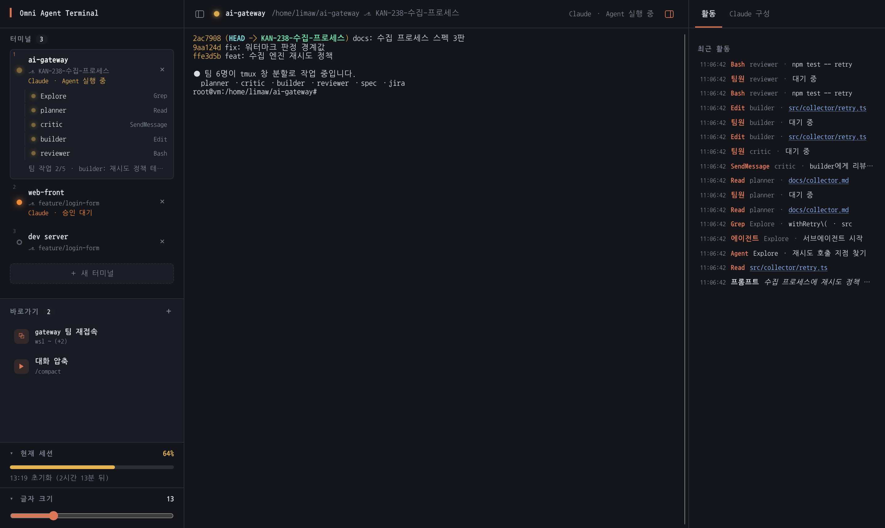
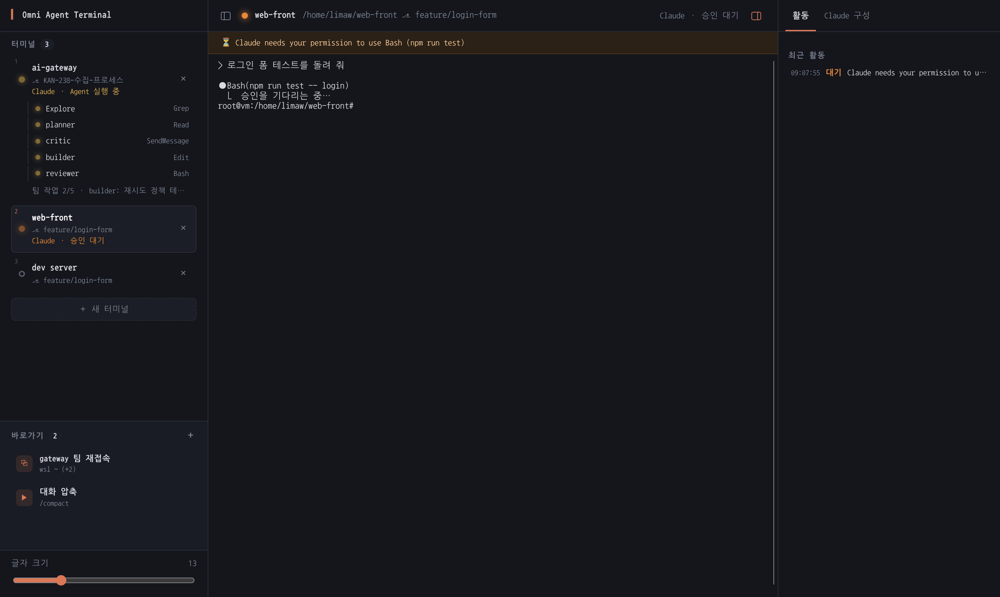
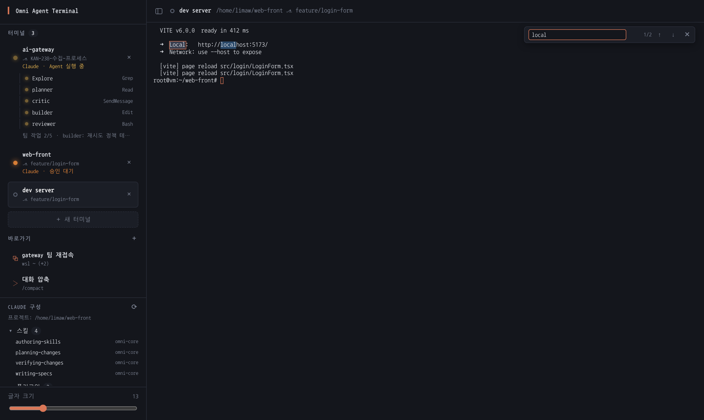
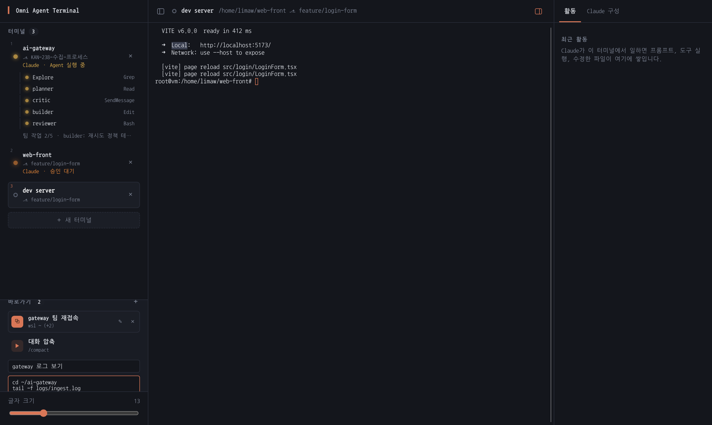
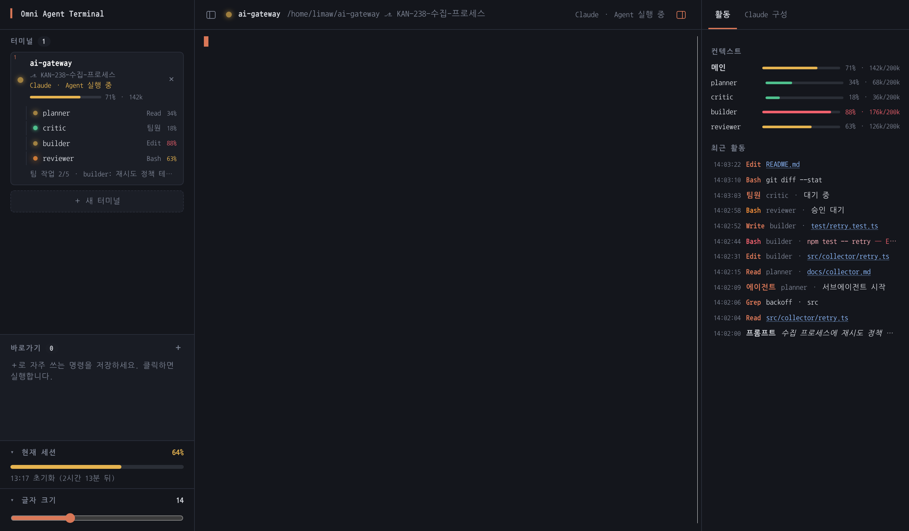
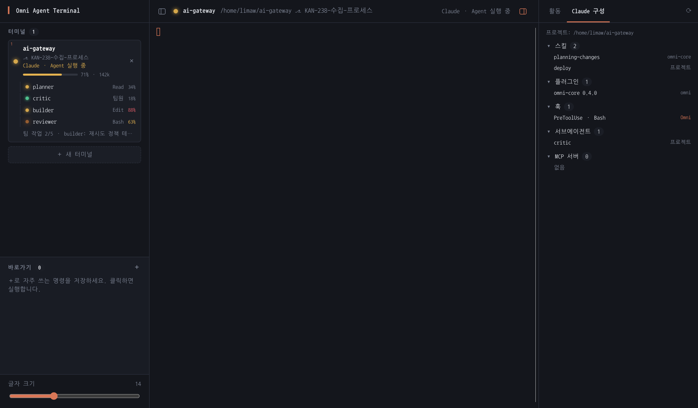

# Omni Agent Terminal

일반 터미널처럼 쓰면서 여러 Claude Code 세션을 **한 창**에서 오가는 Electron 데스크톱 앱입니다.
왼쪽은 직접 만든 UI(터미널 목록, Claude 상태, 서브에이전트와 팀원 트리, 바로가기), 가운데는 실제 터미널, 오른쪽은 상세 패널(활동 기록, 컨텍스트, Claude 구성)입니다. 터미널 화면은 xterm.js가 그리고, 실제 PowerShell 프로세스는 node-pty가 연결합니다.



<details>
<summary>예시 화면 더 보기</summary>

| 승인 대기 | 출력 검색 | 바로가기 추가 |
|---|---|---|
|  |  |  |

| 상세 패널: 활동 | 상세 패널: Claude 구성 |
|---|---|
|  |  |

예시 화면은 실제 앱 화면과 실제 셸로 찍었고, Claude 상태는 실제와 같은 형식의 훅 신호를 넣어 재현했습니다.
</details>

## 한눈에 보는 기능

| 분류 | 기능 |
|---|---|
| 🖥️ **터미널** | 앱을 켜면 PowerShell이 바로 열림 · 여러 터미널을 탭처럼 추가·전환·닫기 · 사이드바와 터미널이 같은 배경색·폰트로 한 화면처럼 보임 |
| ⏩ **빠른 전환** | `Ctrl+1`~`Ctrl+9`로 n번째 터미널, `Ctrl+Tab` / `Ctrl+Shift+Tab`으로 다음·이전 터미널. 카드 왼쪽 위에 번호 표시 |
| 📋 **복사·붙여넣기·검색·링크** | 선택 후 `Ctrl+Shift+C`·우클릭·`Ctrl+C`(선택이 있을 때만)로 복사, `Ctrl+Shift+V`·우클릭으로 붙여넣기, `Ctrl+Shift+F`로 출력 검색(일치 개수 표시), URL은 `Ctrl+클릭`으로 브라우저에서 열기 |
| 📁 **위치 표시** | 터미널 이름이 현재 폴더 이름으로 자동 변경 · git 브랜치(`⎇`) 표시 · `cd`하면 즉시 반영 |
| ⚡ **바로가기** | 자주 쓰는 명령(여러 줄 가능)을 이름과 함께 저장해 두고 클릭으로 실행. 새 터미널에서 실행하거나(세션 재접속용) 현재 터미널에 입력. 추가·편집·삭제, 앱을 다시 켜도 유지 |
| ✏️ **이름 바꾸기** | 터미널 이름을 더블클릭(사이드바·상단 바)하거나 F2로 직접 지정. 비우면 다시 폴더 이름을 따라감 |
| ↕️ **순서 바꾸기** | 사이드바에서 터미널을 끌어다 놓거나 단축키로 위·아래 이동 |
| 🤖 **Claude 상태** | 터미널마다 Claude가 `작업 중` / `Bash 실행 중`(지금 쓰는 도구) / `승인 대기` / `대기` / `오류`인지 LED와 문구로 표시 |
| 🌳 **서브에이전트·팀** | Claude가 띄운 서브에이전트와 에이전트 팀 팀원을 트리로 표시하고, 각자의 상태와 도구를 보여 줌 |
| 🎯 **팀원 창으로 이동** | tmux 창 분할 팀에서 팀원(또는 `Claude ·` 줄)을 클릭하면 그 tmux 창(pane)이 선택됨 |
| 📊 **컨텍스트 사용량** | Claude 세션마다 컨텍스트를 얼마나 썼는지 막대와 `71% · 142k`로 표시(60% 노랑, 85% 빨강). 팀원도 각자 표시 |
| 📝 **활동 기록** | 오른쪽 상세 패널에 프롬프트, 도구 실행(읽은·수정한 파일, 명령), 실패, 승인 대기, 응답 완료를 시간순으로 기록. 파일을 클릭하면 VS Code로 열림 |
| ✅ **작업 진행률** | Claude의 작업 목록 진행률(`작업 1/4 · 담당자: 작업명`) 표시 |
| 🔔 **알림 배너** | 승인 대기 메시지, API 오류, 셸 출력의 오류 줄(`Error: ...`, `command not found` 등)을 상단에 표시 |
| 🪟 **tmux 지원** | 앱 터미널에서 접속한 tmux 안의 `claude`도 상태 표시(앱보다 먼저 만든 세션, 창 분할 팀 포함). 설정은 자동 |
| 🐧 **WSL·Linux** | 앱 터미널에서 `wsl`로 들어간 Ubuntu 안에서도 위치·Claude 상태 표시 · Linux/WSL에서 앱을 직접 실행하는 설치 스크립트 |
| 🧩 **Claude 구성** | 상세 패널의 `Claude 구성` 탭. 선택한 터미널의 프로젝트에서 Claude가 불러오는 스킬·플러그인(켜짐/꺼짐)·훅·서브에이전트·MCP 서버 목록. 사용자·프로젝트·로컬 설정과 켜진 플러그인을 합쳐 보여 주고, WSL 터미널은 WSL 쪽 설정을 읽음 |
| ↔️ **패널 크기** | 사이드바 오른쪽 경계를 끌어 너비 조절(200~600px, 더블클릭: 기본 너비) · 상세 패널 왼쪽 경계도 같은 방식(240~640px), 상단 바 오른쪽 버튼이나 `Ctrl+Shift+I`로 접기/펴기 · 터미널 목록과 바로가기 사이 경계를 위아래로 끌어 높이 조절(끝까지 끌면 한쪽을 완전히 숨기고 다른 쪽이 전체를 씀, 손잡이를 다시 끌거나 더블클릭하면 복원) · 상단 바 버튼이나 `Ctrl+Shift+B`로 접기/펴기. 모두 기억 |
| ⚙️ **설정** | 글자 크기 슬라이더(설정 기억) · 한글 코딩 글꼴 내장(시스템 글꼴 불필요) |
| 🔒 **안전** | 훅은 앱에서 연 터미널의 `claude`에만 적용(사용자 설정 파일은 수정하지 않음) · 신호 수신기는 `127.0.0.1` 전용이고 실행마다 새 토큰 확인 · 앱은 한 번에 하나만 실행 |

### 단축키

| 키 | 동작 |
|---|---|
| `Ctrl+Shift+T` | 새 터미널 |
| `Ctrl+Shift+W` | 현재 터미널 닫기(마지막 터미널이면 창도 닫힘) |
| `F2` / 이름 더블클릭 | 터미널 이름 바꾸기(`Enter` 저장, `Esc` 취소) |
| `Ctrl+1` ~ `Ctrl+9` | n번째 터미널로 전환 |
| `Ctrl+Tab` / `Ctrl+Shift+Tab` | 다음 / 이전 터미널 |
| `Ctrl+Shift+B` | 사이드바 접기/펴기 |
| `Ctrl+Shift+I` | 상세 패널(활동 · Claude 구성) 접기/펴기 |
| `F12` | 개발자 도구(문제 확인용). Windows·Linux에서는 Electron 기본 메뉴를 없애서 `Ctrl+R`(새로고침) 같은 메뉴 단축키는 동작하지 않습니다 |
| `Ctrl+Shift+C` / `Ctrl+Shift+V` | 복사 / 붙여넣기 |
| `Ctrl+C` | 선택한 글자가 있으면 복사, 없으면 평소처럼 실행 중단(`^C`) |
| 우클릭 | 선택이 있으면 복사, 없으면 붙여넣기(Windows Terminal과 같음) |
| `Ctrl+Shift+A` | 전체 선택 |
| `Ctrl+Shift+F` | 출력 검색(`Enter` 다음, `Shift+Enter` 이전, `Esc` 닫기) |
| `Ctrl+클릭` | 출력의 URL을 기본 브라우저로 열기 |
| `Ctrl+Shift+PageUp` / `PageDown` | 선택한 터미널을 위·아래로 이동(사이드바 항목에 포커스가 있으면 `Alt+↑` / `Alt+↓`도 가능) |

### LED 색

🟡 작업 중 · 🟠 승인 대기 · 🟢 대기 · 🔴 오류 · ⚫ 종료 · ○ Claude 없이 셸만 실행 중

## 실행 (Windows)

Node.js 20 이상이 필요합니다.

```bash
cd claude-code/apps/agent-terminal
npm install
npm start
```

- 앱을 켜면 홈 폴더에서 PowerShell이 바로 열립니다. 평소처럼 `cd`로 프로젝트에 가서 `claude`를 실행하면 됩니다.
- 터미널 창 없이 띄우려면 바탕화면 바로가기의 대상에 `"<앱 폴더>\node_modules\electron\dist\electron.exe" "<앱 폴더>"`를 넣으세요. `npm start`는 개발용입니다.
- **업데이트:** `git pull`은 앱을 켠 채로 받아도 됩니다. 새 코드는 앱을 껐다 켜야 반영됩니다(앱 안의 터미널과 Claude도 같이 종료되며, 대화는 `claude --continue`로 이어 갈 수 있음).
- Windows에서는 별도 빌드 도구가 필요 없습니다. node-pty 1.1 패키지에 `prebuilds/win32-x64`, `win32-arm64` 바이너리가 들어 있습니다.
- macOS에서는 `$SHELL`을 사용합니다. Linux는 아래 "실행 (Linux · WSL 안에서)"를 보세요.

## 실행 (Linux · WSL 안에서)

설치 스크립트 하나로 준비가 끝납니다. Node.js 20 이상만 미리 있으면 됩니다.

```bash
cd claude-code/apps/agent-terminal
scripts/setup-linux.sh
omni-agent-terminal
```

`setup-linux.sh`가 하는 일(`--dry-run`을 붙이면 실행하지 않고 할 일만 보여 줌):

1. **패키지 설치 (sudo 요청):** node-pty 빌드 도구(`build-essential`, `python3`)와 Electron 실행 라이브러리(GTK3, NSS, ALSA 등)를 설치합니다. Ubuntu 버전마다 다른 패키지 이름(24.04의 `*t64` 등)은 자동으로 고릅니다.
2. **`npm install`:** node-pty가 이 단계에서 Linux용으로 빌드됩니다. 실패하면 한 번 더 빌드를 시도합니다.
3. **Electron 샌드박스 권한:** `chrome-sandbox`에 root 소유와 setuid를 설정합니다. 설정하지 못하면 실행기가 `--no-sandbox`로 대신 실행합니다.
4. **실행기와 메뉴 항목 생성:** 실행기 `~/.local/bin/omni-agent-terminal`과 앱 메뉴 항목을 만듭니다. 실행기는 앱을 터미널과 분리해서 띄우므로, 실행한 터미널을 닫아도 앱은 남습니다.

**한글 글꼴:** 앱에 Nanum Gothic Coding(OFL-1.1, npm `@fontsource/nanum-gothic-coding`)이 들어 있어, 시스템에 한글 글꼴이 없어도 깨지지 않습니다.

**한글 입력:** WSLg에서 띄운 Linux 앱에는 Windows 한글 입력기가 전달되지 않습니다. 한글을 쓰려면 WSL 안에 Linux 입력기(fcitx5 등)를 따로 설정하거나, Windows용 앱에서 `wsl`로 들어가는 방식(아래 "WSL에서 쓰기"의 A)을 쓰세요.

**WSL에서:** Windows 11(WSLg)이면 앱 창이 Windows 바탕화면에 뜨고, 메뉴 항목이 Windows 시작 메뉴에 나타날 수 있습니다. 이때 프로젝트는 `/mnt/c/...`가 아니라 **WSL 홈에 따로 clone**하세요. Windows용 `node_modules`는 Linux에서 동작하지 않습니다.

## WSL에서 쓰기

방법은 두 가지입니다.

| | A. Windows 앱에서 `wsl` 입력 | B. 앱을 WSL 안에서 실행 |
|---|---|---|
| 설치 | Windows에서 `npm install` | WSL에서 `scripts/setup-linux.sh` |
| 터미널 | PowerShell(필요할 때 `wsl`로 Ubuntu 진입) | Ubuntu bash |
| 조건 | WSL **mirrored 네트워킹**(설정 후 `wsl --shutdown` 필요) | WSLg(Windows 11). 네트워킹 설정 불필요 |

B는 위 "실행 (Linux · WSL 안에서)"를 따르면 됩니다. 아래는 A 방식의 설명입니다.

앱의 PowerShell 터미널에서 `wsl`을 입력하면 Ubuntu bash로 들어가고, 그 안에서도 경로 표시와 Claude 상태 표시가 동작합니다.

- **`wsl` 입력 방식:** `wsl`, `wsl ~`, `wsl -d <배포판>`처럼 명령 없이 들어가는 경우에만 연동된 bash가 열립니다. `wsl ls`처럼 명령을 붙이면 평소의 `wsl.exe`가 그대로 실행됩니다.
- **환경 변수 전달:** 앱이 `WSLENV`로 필요한 값을 넘기고, 파일 경로는 `/mnt/c/...`로 자동 변환됩니다.
- **Linux 경로 읽기:** WSL 안의 경로(`/home/...`)는 `\\wsl.localhost\<배포판>\...`로 읽어 git 브랜치를 표시합니다. 팀 파일(`~/.claude`)도 WSL 쪽 홈에서 읽습니다.
- **필요한 것: mirrored 네트워킹.** WSL2 기본 모드(NAT)에서는 WSL 안의 `127.0.0.1`이 Windows를 가리키지 않아 앱에 신호가 닿지 않습니다. 이때는 WSL에 들어갈 때 노란 경고가 뜹니다. `%UserProfile%\.wslconfig`에 아래를 넣고 PowerShell에서 `wsl --shutdown`을 실행한 뒤 다시 들어가세요(Windows 11 22H2 이상).
  ```ini
  [wsl2]
  networkingMode=mirrored
  ```
- **필요한 것: curl.** WSL 안에 `curl`이 있어야 합니다(`sudo apt install curl`).
- **WSL 안에서 쓰는 Claude:** WSL에 설치된 `claude`가 실행됩니다. Windows의 `claude.exe`가 아닙니다.

## tmux 안에서 쓰기

앱 터미널에서 tmux에 접속해(`tmux attach` 등) 그 안에서 `claude`를 실행해도 LED와 상태가 표시됩니다. 앱보다 먼저 만들어 둔 tmux 세션과 에이전트 팀의 **tmux 창 분할 모드**(`teammateMode: tmux`)도 됩니다.

**설정은 자동입니다.** 앱 터미널의 bash(Linux 앱, 또는 Windows 앱에서 `wsl`로 들어간 bash)가 시작될 때 tmux가 설치돼 있으면, 필요한 훅을 알아서 설치하고 처음 한 번만 안내를 띄웁니다. 이미 최신이면 아무것도 하지 않습니다.
- **적용 시점:** 설정 전에 이미 실행 중이던 `claude`는 다시 시작해야 적용됩니다(`claude --continue`로 대화 유지).
- **설치 내용:** 훅 스크립트를 `~/.local/share/omni-agent-terminal/claude-hook.sh`에 복사하고, Claude 사용자 설정(`~/.claude/settings.json`)에 command 훅으로 추가합니다. 기존 설정은 `settings.json.omni-backup-<시각>`으로 백업하고, 다른 설정과 훅은 건드리지 않습니다.
- **끄기·제거:** 자동 설정을 끄려면 `OMNI_NO_AUTO_SETUP=1`로 두세요. 제거는 앱 bash에서 `omni-tmux-setup --remove`(또는 `bash <앱 폴더>/src/shell-init/omni-tmux-setup.sh --remove`)입니다.
- **창 분할 팀 표시:** 리더가 메인 LED를 쓰고, 각 창의 팀원은 그 아래 목록에 이름(`alpha`, `planner` 등)과 상태로 표시됩니다. 같은 tmux 세션에 다른 `claude`가 하나 더 있으면 `claude %5`처럼 따로 표시됩니다.
- **창으로 이동:** 목록의 팀원을 클릭하면 앱이 그 tmux 서버에 `select-window`·`select-pane`을 보내 해당 창을 선택합니다(Windows 앱이면 셸을 거치지 않도록 `wsl.exe -d <배포판> -e tmux ...`). 이동할 수 없으면 카드가 잠깐 흔들립니다.

**동작 원리:** tmux 창의 셸에는 앱 정보가 없지만, 그 세션을 화면에 띄우는 tmux 클라이언트는 앱 터미널에서 실행됐으므로 앱 주소·토큰·터미널 번호를 환경 변수로 갖고 있습니다. 훅은 현재 세션에 붙은 클라이언트의 환경(`/proc/<pid>/environ`)에서 이 값을 찾아 그 앱 터미널로 신호를 보냅니다. 세션을 앱 터미널 두 곳에서 띄우고 있으면 두 곳 모두에 표시됩니다.
- **앱과 무관한 경우:** 앱 밖의 tmux나 일반 터미널, 또는 앱의 `claude` 래퍼로 실행한 `claude`(이미 `--settings`로 보고함)에서는 아무 출력 없이 바로 끝납니다.
- **필요한 것:** `curl`, `python3`(설치 때만)이 필요합니다.
- **Linux 전용:** `/proc`를 쓰는 방식이라 Linux·WSL 전용입니다.

## 바로가기

사이드바 `＋ 새 터미널` 아래의 **바로가기**에 자주 쓰는 명령을 저장해 두고 클릭해서 실행합니다. 명령을 프롬프트에 입력하는 방식이라 Windows·WSL·Linux 구분 없이 같은 방식으로 동작합니다.

- **추가:** `＋`를 누르고 이름, 명령(한 줄에 하나), **새 터미널에서 실행** 여부를 정해 저장합니다.
- **실행:** 클릭(또는 선택 후 `Enter`)하면 명령을 한 줄씩 입력합니다. 각 줄은 앞 줄의 출력이 0.5초 동안 멈춘 뒤 입력됩니다. 출력 없이 오래 걸리는 명령 뒤의 줄은 미리 입력된 상태로 대기하다가 셸이 순서대로 실행합니다.
- **새 터미널에서 실행 (기본):** 새 터미널을 열고 바로가기 이름을 붙인 뒤 실행합니다. 세션 재접속에 씁니다. 아래는 예시입니다.
  ```
  wsl ~
  cd sample-app
  tmux attach -t sample-app
  ```
- **현재 터미널에서 실행:** 체크를 끄면 지금 선택된 터미널에 입력합니다. 자주 보내는 Claude 명령(예: `/compact`)에 쓸 수 있습니다.
- **편집·삭제:** 항목에 마우스를 올리면 나오는 ✎ / ✕로 합니다. 바로가기는 앱을 다시 켜도 유지됩니다.

## Claude 구성 목록

오른쪽 상세 패널의 `Claude 구성` 탭은 **선택한 터미널의 현재 프로젝트**에서 Claude Code가 불러올 구성을 보여 줍니다. 프로젝트는 현재 폴더에서 위로 올라가며 처음 만나는 `.git` 또는 `.claude` 폴더 기준입니다. 탭이 보이는 동안 터미널을 바꾸거나 `cd`할 때, 앱 창으로 돌아올 때, ⟳ 버튼을 누를 때 다시 읽습니다(탭이 닫혀 있으면 읽지 않음). 파일을 읽기만 하고 아무것도 실행하지 않습니다.

| 항목 | 읽는 곳 |
|---|---|
| 스킬 | `~/.claude/skills/*/SKILL.md`, `<프로젝트>/.claude/skills/`, `commands/*.md`, 켜진 플러그인의 `skills/`·`commands/` |
| 플러그인 | `~/.claude/plugins/installed_plugins.json`(설치)과 `enabledPlugins`(사용자 → 프로젝트 → 로컬 순으로 덮어씀). 꺼진 플러그인은 취소선, 켜져 있지만 설치되지 않은 것은 `미설치` |
| 훅 | 사용자·프로젝트·로컬 설정의 `hooks`와 켜진 플러그인의 `hooks/hooks.json`. 이 앱의 tmux 훅은 `Omni`로 표시 |
| 서브에이전트 | `~/.claude/agents/`, `<프로젝트>/.claude/agents/`, 켜진 플러그인의 `agents/` |
| MCP 서버 | `~/.claude.json`의 `mcpServers`(사용자)와 `projects.<경로>.mcpServers`(로컬), `<프로젝트>/.mcp.json`, 켜진 플러그인의 `.mcp.json` |

- 항목에 마우스를 올리면 설명, 명령, 전체 이름이 보입니다.
- 그룹 펼침 상태는 기억됩니다.
- `installed_plugins.json`과 플러그인 캐시 형식은 Claude Code 2.1.318에서 실제 파일을 보고 맞췄고, 공식 문서에는 없습니다.

## 활동 기록과 컨텍스트

상세 패널의 `활동` 탭은 선택한 터미널에서 Claude가 한 일을 최신순으로 보여 줍니다(터미널당 최근 200줄, 앱을 끄면 사라짐).

| 표시 | 언제 |
|---|---|
| `프롬프트` | 사용자가 프롬프트를 보냄(첫 줄) |
| `Read` `Edit` `Bash` … | 도구 실행. 파일 도구는 경로(현재 폴더 기준 상대 경로), `Bash`는 명령 첫 줄, `Grep`은 패턴, `Agent`는 서브에이전트 종류와 설명 |
| 빨간 줄 | 도구 실패. 오류 메시지가 뒤에 붙음 |
| `대기` | 승인 요청, 알림 |
| `완료` · `오류` | 응답 완료, API 오류로 중단 |
| `에이전트` · `팀원` | 서브에이전트 시작·종료, 팀원 대기 |

- 서브에이전트나 팀원이 한 일은 줄 앞에 이름(`builder ·`)이 붙습니다.
- 파일 경로를 클릭하면 VS Code에서 엽니다(`vscode://file/...`, WSL 터미널이면 `vscode://vscode-remote/wsl+<배포판>/...`로 WSL 원격 연결). 앱은 활동 기록에 나온 파일만 열어 줍니다. `vscode://` 링크를 처리할 앱(VS Code)이 없으면 열지 않고 경로가 잠깐 빨갛게 바뀝니다.
- 승인 요청은 `PermissionRequest` 한 줄만 남깁니다(같은 내용의 `permission_prompt` 알림은 생략).

**컨텍스트 사용량**은 훅 신호에 들어 있는 대화 기록 파일(`transcript_path`, JSONL)의 마지막 응답 `usage`에서 계산합니다: `input_tokens + cache_creation_input_tokens + cache_read_input_tokens + output_tokens`. 파일 끝 64KB를 먼저 읽고, 거기에 응답이 없을 때만 512KB까지 읽습니다. 세션마다 3초에 한 번 이하로 읽고, 응답이 끝나면(`Stop`) 항상 읽습니다(그때 읽기가 진행 중이면 끝난 뒤 한 번 더). `/compact`나 자동 압축 직후에는 기록의 `compact_boundary` 줄에 적힌 압축 후 크기(`postTokens`)를 씁니다. 컨텍스트 창 크기는 기록에 없어서 **추정값**입니다: 200k로 보고, 그보다 많이 쓰면 1M 창으로 보며, 한 번 1M으로 본 세션은 압축 후에도 1M으로 봅니다. 상세 패널 맨 위에는 메인과 팀원 각각의 사용량이 `142k/200k`처럼 표시됩니다.

## 기능 상세

| 영역 | 동작 |
|---|---|
| 터미널 목록 | 이름은 현재 폴더 이름, 둘째 줄은 git 브랜치(`⎇`)입니다. `cd`하면 따라 바뀝니다. 직접 지정한 이름은 `cd`해도 유지되고, 앱을 재시작하면 터미널과 함께 초기화됩니다 |
| Claude 상태 | 그 터미널에서 `claude`가 실행 중이면 셋째 줄에 `작업 중`, `Bash 실행 중`, `승인 대기`, `대기`, `오류`가 표시됩니다 |
| 서브에이전트와 팀원 | Claude가 띄운 서브에이전트(`Explore` 등)와 에이전트 팀 팀원이 목록 아래 트리로 표시되고, 각각 LED와 지금 쓰는 도구가 보입니다 |
| 작업 진행률 | 작업 목록이 있으면 `작업 1/4 · beta: 로그인 API 테스트 작성`처럼 표시됩니다(팀이면 `팀 작업`) |
| 상단 배너 | 🟠 승인 대기 메시지, 🔴 API 오류, 또는 셸 출력의 오류 줄을 표시합니다. 셸 출력 오류는 Claude가 실행 중이거나 tmux·vim 같은 전체 화면 프로그램이 떠 있을 때는 표시하지 않습니다(Claude 화면의 `Error:` 문구 오탐 방지). 배너를 클릭하면 닫힙니다 |
| 새 터미널 / 닫기 | `＋ 새 터미널` 또는 `Ctrl+Shift+T` / `✕` 또는 `Ctrl+Shift+W`. 마지막 터미널을 닫으면 창도 닫힙니다 |
| 글자 크기 | 모든 터미널에 적용되고, 설정이 기억됩니다 |

## Claude 상태는 어떻게 알아내나

Claude Code의 [HTTP 훅](https://code.claude.com/docs/en/hooks)을 씁니다. **앱에서 연 터미널에만** 적용되고, 사용자 설정 파일(`~/.claude/settings.json`)은 건드리지 않습니다.

1. 앱이 켜질 때 `127.0.0.1`의 임의 포트에 신호 수신기를 열고, 그 주소를 담은 훅 설정 파일을 앱 데이터 폴더에 씁니다(`claude-hooks.json`).
2. 앱 터미널의 셸에는 `claude` 함수가 정의됩니다. 사용자가 `claude`를 입력하면 실제 `claude`에 `--settings <훅 설정 파일>`이 붙어 실행됩니다(`src/shell-init/`). 앱 밖의 터미널에는 아무 영향이 없습니다.
3. Claude가 프롬프트 처리, 도구 실행, 승인 요청, 응답 완료 같은 이벤트마다 수신기로 POST합니다. 헤더의 터미널 번호(`OMNI_TERMINAL_ID`)로 어느 탭인지, 본문의 `agent_id`와 `agent_type`으로 어느 서브에이전트나 팀원인지 구분합니다. 요청마다 실행 시 생성한 토큰을 확인합니다.
4. 팀원 목록은 `~/.claude/teams/session-<세션 앞 8자리>/config.json`, 작업 진행률은 `~/.claude/tasks/`를 2초마다 읽어 합칩니다.

검증한 범위(Linux, Claude Code 2.1.318):
- **확인함:** tmux 안의 실제 `claude` → 사용자 설정 command 훅 → 앱 터미널로 전달(앱보다 먼저 만든 세션 포함), `--settings`로 넘긴 HTTP 훅 실행, 헤더의 환경 변수 치환, 서브에이전트 신호, 대화형 세션의 에이전트 팀(`alpha`, `beta` 2명) 표시와 해산 후 정리
- **Windows에서 확인함:** PowerShell 연동 로드, `claude` 래퍼, `cd` 후 경로와 브랜치 표시
- **사용자 환경에서 확인함:** WSLg에서 Electron 창 실행
- **확인 못 함:** `setup-linux.sh`의 실제 설치 단계(`--dry-run`과 실행기 생성만 확인), Windows에서의 Claude 상태 표시, WSL 연동(Linux bash에서 WSL 환경을 흉내 낸 테스트만 통과), 팀 작업 진행률(실험에서 Claude가 작업 목록을 만들지 않았음)
- **문서화되지 않은 형식:** 팀 설정과 작업 파일 형식은 공식 문서에 없어서 실제 파일을 보고 맞췄습니다. 버전이 바뀌면 달라질 수 있습니다

## 구조

```text
src/
├── main.js            # Electron 메인: 창, IPC, 훅 수신기 시작, 단일 인스턴스
├── preload.js         # contextBridge로 window.agentApi만 노출
├── sessions.js        # SessionManager: 터미널당 PTY 하나 + 그 안의 Claude 상태
├── agent-state.js     # 순수 로직: 훅 이벤트 → 상태 (메인, 서브에이전트, 팀원)
├── hook-server.js     # 127.0.0.1 HTTP 훅 수신기 (토큰 확인)
├── claude-settings.js # --settings로 넘길 훅 설정 생성
├── shell.js           # 셸 실행 방법(PowerShell/bash/zsh) + 현재 폴더 보고 파싱
├── shell-init/        # 앱 터미널 전용 셸 연동: claude 래퍼, 프롬프트마다 현재 폴더 보고,
│                      #   tmux용 훅(claude-hook.sh)과 설치 스크립트(omni-tmux-setup.sh)
├── git.js             # .git/HEAD로 브랜치 읽기 (git 프로세스 없음)
├── wsl.js             # WSL 경로 ↔ Windows 경로 변환, WSLENV 구성
├── teams.js           # ~/.claude/teams, ~/.claude/tasks 읽기
├── claude-config.js   # 스킬·플러그인·훅·서브에이전트·MCP 목록 읽기
├── activity.js        # 훅 이벤트 → 활동 기록 한 줄 (도구 입력 요약)
├── usage.js           # 대화 기록(JSONL) 끝에서 컨텍스트 사용량 읽기
├── tmux.js            # tmux 명령 실행 (Windows면 wsl.exe 경유)
├── status.js          # 셸 출력의 오류 줄 감지
└── renderer/          # index.html · styles.css · renderer.js (xterm.js 화면, 사이드바 트리, 상세 패널, 단축키)
scripts/setup-linux.sh # Linux·WSL 설치 자동화 (패키지, npm install, 샌드박스, 실행기)
test/                  # node --test
```

- 보안: `contextIsolation: true`, `nodeIntegration: false`, `sandbox: true`, CSP `script-src 'self'`를 적용했습니다. 앱 창은 다른 페이지로 이동하거나 새 창을 열지 않습니다.
- 디자인: 사이드바, 터미널, 창 배경을 같은 색(`#14161c`)으로 맞추고, 같은 코딩 폰트(D2Coding → Cascadia Code → Fira Code → Consolas 순)를 씁니다. 이 색을 바꿀 때는 `styles.css`의 `--bg`, `renderer.js`의 `TERMINAL_THEME.background`, `main.js`의 `backgroundColor` 세 곳을 함께 수정하세요.

## 테스트

```bash
npm test
```

node-pty가 현재 Node 버전용으로 빌드돼 있지 않으면 실제 PTY 통합 테스트는 건너뜁니다.

## 한계와 다음 단계

- 셸 연동은 PowerShell, bash, zsh만 지원합니다. 다른 셸에서는 Claude 상태와 현재 폴더가 표시되지 않습니다.
- 에이전트 팀은 Claude Code의 실험 기능입니다(`CLAUDE_CODE_EXPERIMENTAL_AGENT_TEAMS=1`).
- 화면을 새로고침하면 실행 중인 세션은 다시 연결되지만, 그 전에 출력된 내용(스크롤백)은 사라집니다.
- 다음 단계 후보: 백그라운드 탭 알림(Windows 알림, 작업 표시줄 깜빡임), 프로젝트 바로가기, 세션 복원, 화면 분할, 설치 파일(.exe) 패키징.
