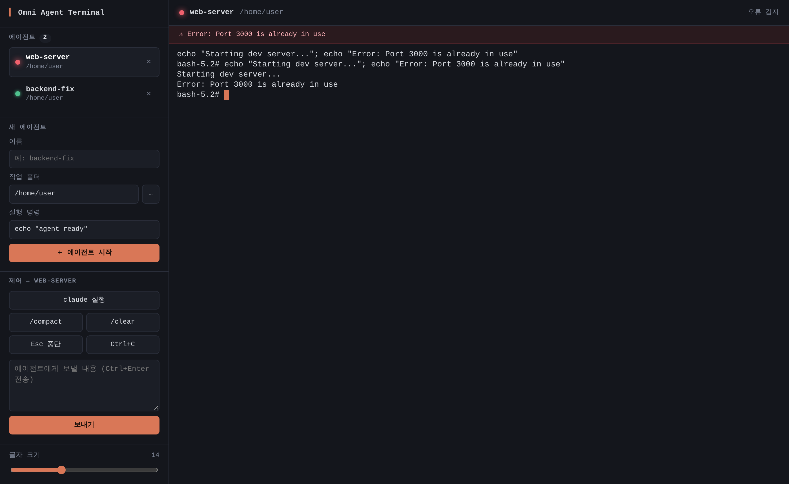

# Omni Agent Terminal

일반 터미널처럼 쓰면서 여러 Claude Code 세션을 **한 창**에서 오가는 Electron 데스크톱 앱입니다.
왼쪽은 직접 만든 UI(터미널 목록, Claude 상태, 서브에이전트와 팀원 트리)이고, 오른쪽은 실제 터미널입니다. 터미널 화면은 xterm.js가 그리고, 실제 PowerShell 프로세스는 node-pty가 연결합니다.



## 한눈에 보는 기능

| 분류 | 기능 |
|---|---|
| 🖥️ **터미널** | 앱을 켜면 PowerShell이 바로 열림 · 여러 터미널을 탭처럼 추가·전환·닫기 · 사이드바와 터미널이 같은 배경색·폰트로 한 화면처럼 보임 |
| 📁 **위치 표시** | 터미널 이름이 현재 폴더 이름으로 자동 변경 · git 브랜치(`⎇`) 표시 · `cd`하면 즉시 반영 |
| ✏️ **이름 바꾸기** | 터미널 이름을 더블클릭(사이드바·상단 바)하거나 F2로 직접 지정. 비우면 다시 폴더 이름을 따라감 |
| 🤖 **Claude 상태** | 터미널마다 Claude가 `작업 중` / `Bash 실행 중`(지금 쓰는 도구) / `승인 대기` / `대기` / `오류`인지 LED와 문구로 표시 |
| 🌳 **서브에이전트·팀** | Claude가 띄운 서브에이전트와 에이전트 팀 팀원을 트리로 표시하고, 각자의 상태와 도구를 보여 줌 |
| ✅ **작업 진행률** | Claude의 작업 목록 진행률(`작업 1/4 · 담당자: 작업명`) 표시 |
| 🔔 **알림 배너** | 승인 대기 메시지, API 오류, 셸 출력의 오류 줄(`Error: ...`, `command not found` 등)을 상단에 표시 |
| 🐧 **WSL·Linux** | 앱 터미널에서 `wsl`로 들어간 Ubuntu 안에서도 위치·Claude 상태 표시 · Linux/WSL에서 앱을 직접 실행하는 설치 스크립트 |
| ⌨️ **한글 입력** | 시스템 입력기가 닿지 않는 환경(WSL 안의 앱 등)을 위한 내장 두벌식 입력. 조합 중인 글자를 커서 위치에 표시하고, 상단의 `한`/`A` 표시로 상태를 보여 줌 |
| ⚙️ **설정** | 글자 크기 슬라이더 · 내장 한글 입력 켜기/끄기(설정 기억) · 한글 코딩 글꼴 내장(시스템 글꼴 불필요) |
| 🔒 **안전** | 훅은 앱에서 연 터미널의 `claude`에만 적용(사용자 설정 파일은 수정하지 않음) · 신호 수신기는 `127.0.0.1` 전용이고 실행마다 새 토큰 확인 · 앱은 한 번에 하나만 실행 |

### 단축키

| 키 | 동작 |
|---|---|
| `Ctrl+Shift+T` | 새 터미널 |
| `Ctrl+Shift+W` | 현재 터미널 닫기(마지막 터미널이면 창도 닫힘) |
| `F2` / 이름 더블클릭 | 터미널 이름 바꾸기(`Enter` 저장, `Esc` 취소) |
| 한/영 키 · 오른쪽 `Alt` · `Shift+Space` | 한/영 전환(내장 한글 입력을 켰을 때) |

### LED 색

🟡 작업 중 · 🟠 승인 대기 · 🟢 대기 · 🔴 오류 · ⚫ 종료 · ○ Claude 없이 셸만 실행 중

## 실행 (Windows)

Node.js 20 이상이 필요합니다.

```bash
cd claude-code/apps/agent-terminal
npm install
npm start
```

- 앱을 켜면 홈 폴더에서 PowerShell이 바로 열립니다. 평소처럼 `cd`로 프로젝트에 가서 `claude`를 실행하면 됩니다.
- 터미널 창 없이 띄우려면 바탕화면 바로가기의 대상에 `"<앱 폴더>\node_modules\electron\dist\electron.exe" "<앱 폴더>"`를 넣으세요. `npm start`는 개발용입니다.
- **업데이트:** `git pull`은 앱을 켠 채로 받아도 됩니다. 새 코드는 앱을 껐다 켜야 반영됩니다(앱 안의 터미널과 Claude도 같이 종료되며, 대화는 `claude --continue`로 이어 갈 수 있음).
- Windows에서는 별도 빌드 도구가 필요 없습니다. node-pty 1.1 패키지에 `prebuilds/win32-x64`, `win32-arm64` 바이너리가 들어 있습니다.
- macOS에서는 `$SHELL`을 사용합니다. Linux는 아래 "실행 (Linux · WSL 안에서)"를 보세요.

## 실행 (Linux · WSL 안에서)

설치 스크립트 하나로 준비가 끝납니다. Node.js 20 이상만 미리 있으면 됩니다.

```bash
cd claude-code/apps/agent-terminal
scripts/setup-linux.sh
omni-agent-terminal
```

`setup-linux.sh`가 하는 일(`--dry-run`을 붙이면 실행하지 않고 할 일만 보여 줌):

1. **패키지 설치 (sudo 요청):** node-pty 빌드 도구(`build-essential`, `python3`)와 Electron 실행 라이브러리(GTK3, NSS, ALSA 등)를 설치합니다. Ubuntu 버전마다 다른 패키지 이름(24.04의 `*t64` 등)은 자동으로 고릅니다.
2. **`npm install`:** node-pty가 이 단계에서 Linux용으로 빌드됩니다. 실패하면 한 번 더 빌드를 시도합니다.
3. **Electron 샌드박스 권한:** `chrome-sandbox`에 root 소유와 setuid를 설정합니다. 설정하지 못하면 실행기가 `--no-sandbox`로 대신 실행합니다.
4. **실행기와 메뉴 항목 생성:** 실행기 `~/.local/bin/omni-agent-terminal`과 앱 메뉴 항목을 만듭니다. 실행기는 앱을 터미널과 분리해서 띄우므로, 실행한 터미널을 닫아도 앱은 남습니다.

**한글 글꼴:** 앱에 Nanum Gothic Coding(OFL-1.1, npm `@fontsource/nanum-gothic-coding`)이 들어 있어, 시스템에 한글 글꼴이 없어도 깨지지 않습니다.

**한글 입력:** WSLg에서 띄운 Linux 앱에는 Windows 한글 입력기가 전달되지 않아, 앱이 두벌식 한글을 직접 조합합니다. Linux에서는 기본으로 켜져 있고, 사이드바 아래 **내장 한글 입력**으로 끄고 켤 수 있습니다(Windows·macOS는 시스템 입력기를 쓰므로 기본 꺼짐). 전환은 한/영 키, 오른쪽 `Alt`(한국어 키보드에서 한/영 키가 이렇게 들어오는 경우가 많음), `Shift+Space`, 또는 상단의 `한`/`A` 표시를 클릭하면 됩니다. 겹모음·겹받침·받침 넘김을 지원하고, 조합 중에는 백스페이스가 자모를 하나씩 지웁니다. fcitx 같은 Linux 입력기를 따로 쓰면 그 입력이 우선합니다.

**WSL에서:** Windows 11(WSLg)이면 앱 창이 Windows 바탕화면에 뜨고, 메뉴 항목이 Windows 시작 메뉴에 나타날 수 있습니다. 이때 프로젝트는 `/mnt/c/...`가 아니라 **WSL 홈에 따로 clone**하세요. Windows용 `node_modules`는 Linux에서 동작하지 않습니다.

## WSL에서 쓰기

방법은 두 가지입니다.

| | A. Windows 앱에서 `wsl` 입력 | B. 앱을 WSL 안에서 실행 |
|---|---|---|
| 설치 | Windows에서 `npm install` | WSL에서 `scripts/setup-linux.sh` |
| 터미널 | PowerShell(필요할 때 `wsl`로 Ubuntu 진입) | Ubuntu bash |
| 조건 | WSL **mirrored 네트워킹**(설정 후 `wsl --shutdown` 필요) | WSLg(Windows 11). 네트워킹 설정 불필요 |

B는 위 "실행 (Linux · WSL 안에서)"를 따르면 됩니다. 아래는 A 방식의 설명입니다.

앱의 PowerShell 터미널에서 `wsl`을 입력하면 Ubuntu bash로 들어가고, 그 안에서도 경로 표시와 Claude 상태 표시가 동작합니다.

- **`wsl` 입력 방식:** `wsl`, `wsl ~`, `wsl -d <배포판>`처럼 명령 없이 들어가는 경우에만 연동된 bash가 열립니다. `wsl ls`처럼 명령을 붙이면 평소의 `wsl.exe`가 그대로 실행됩니다.
- **환경 변수 전달:** 앱이 `WSLENV`로 필요한 값을 넘기고, 파일 경로는 `/mnt/c/...`로 자동 변환됩니다.
- **Linux 경로 읽기:** WSL 안의 경로(`/home/...`)는 `\\wsl.localhost\<배포판>\...`로 읽어 git 브랜치를 표시합니다. 팀 파일(`~/.claude`)도 WSL 쪽 홈에서 읽습니다.
- **필요한 것: mirrored 네트워킹.** WSL2 기본 모드(NAT)에서는 WSL 안의 `127.0.0.1`이 Windows를 가리키지 않아 앱에 신호가 닿지 않습니다. 이때는 WSL에 들어갈 때 노란 경고가 뜹니다. `%UserProfile%\.wslconfig`에 아래를 넣고 PowerShell에서 `wsl --shutdown`을 실행한 뒤 다시 들어가세요(Windows 11 22H2 이상).
  ```ini
  [wsl2]
  networkingMode=mirrored
  ```
- **필요한 것: curl.** WSL 안에 `curl`이 있어야 합니다(`sudo apt install curl`).
- **WSL 안에서 쓰는 Claude:** WSL에 설치된 `claude`가 실행됩니다. Windows의 `claude.exe`가 아닙니다.

## 기능 상세

| 영역 | 동작 |
|---|---|
| 터미널 목록 | 이름은 현재 폴더 이름, 둘째 줄은 git 브랜치(`⎇`)입니다. `cd`하면 따라 바뀝니다. 직접 지정한 이름은 `cd`해도 유지되고, 앱을 재시작하면 터미널과 함께 초기화됩니다 |
| Claude 상태 | 그 터미널에서 `claude`가 실행 중이면 셋째 줄에 `작업 중`, `Bash 실행 중`, `승인 대기`, `대기`, `오류`가 표시됩니다 |
| 서브에이전트와 팀원 | Claude가 띄운 서브에이전트(`Explore` 등)와 에이전트 팀 팀원이 목록 아래 트리로 표시되고, 각각 LED와 지금 쓰는 도구가 보입니다 |
| 작업 진행률 | 작업 목록이 있으면 `작업 1/4 · beta: 로그인 API 테스트 작성`처럼 표시됩니다(팀이면 `팀 작업`) |
| 상단 배너 | 🟠 승인 대기 메시지, 🔴 API 오류, 또는 셸 출력의 오류 줄을 표시합니다 |
| 새 터미널 / 닫기 | `＋ 새 터미널` 또는 `Ctrl+Shift+T` / `✕` 또는 `Ctrl+Shift+W`. 마지막 터미널을 닫으면 창도 닫힙니다 |
| 글자 크기 | 모든 터미널에 적용되고, 설정이 기억됩니다 |

## Claude 상태는 어떻게 알아내나

Claude Code의 [HTTP 훅](https://code.claude.com/docs/en/hooks)을 씁니다. **앱에서 연 터미널에만** 적용되고, 사용자 설정 파일(`~/.claude/settings.json`)은 건드리지 않습니다.

1. 앱이 켜질 때 `127.0.0.1`의 임의 포트에 신호 수신기를 열고, 그 주소를 담은 훅 설정 파일을 앱 데이터 폴더에 씁니다(`claude-hooks.json`).
2. 앱 터미널의 셸에는 `claude` 함수가 정의됩니다. 사용자가 `claude`를 입력하면 실제 `claude`에 `--settings <훅 설정 파일>`이 붙어 실행됩니다(`src/shell-init/`). 앱 밖의 터미널에는 아무 영향이 없습니다.
3. Claude가 프롬프트 처리, 도구 실행, 승인 요청, 응답 완료 같은 이벤트마다 수신기로 POST합니다. 헤더의 터미널 번호(`OMNI_TERMINAL_ID`)로 어느 탭인지, 본문의 `agent_id`와 `agent_type`으로 어느 서브에이전트나 팀원인지 구분합니다. 요청마다 실행 시 생성한 토큰을 확인합니다.
4. 팀원 목록은 `~/.claude/teams/session-<세션 앞 8자리>/config.json`, 작업 진행률은 `~/.claude/tasks/`를 2초마다 읽어 합칩니다.

검증한 범위(Linux, Claude Code 2.1.318):
- **확인함:** `--settings`로 넘긴 HTTP 훅 실행, 헤더의 환경 변수 치환, 서브에이전트 신호, 대화형 세션의 에이전트 팀(`alpha`, `beta` 2명) 표시와 해산 후 정리
- **Windows에서 확인함:** PowerShell 연동 로드, `claude` 래퍼, `cd` 후 경로와 브랜치 표시
- **사용자 환경에서 확인함:** WSLg에서 Electron 창 실행
- **확인 못 함:** WSLg에서 내장 한글 입력과 한/영 키(Chromium에서 실제 bash로만 확인), `setup-linux.sh`의 실제 설치 단계(`--dry-run`과 실행기 생성만 확인), Windows에서의 Claude 상태 표시, WSL 연동(Linux bash에서 WSL 환경을 흉내 낸 테스트만 통과), 팀 작업 진행률(실험에서 Claude가 작업 목록을 만들지 않았음)
- **문서화되지 않은 형식:** 팀 설정과 작업 파일 형식은 공식 문서에 없어서 실제 파일을 보고 맞췄습니다. 버전이 바뀌면 달라질 수 있습니다

## 구조

```text
src/
├── main.js            # Electron 메인: 창, IPC, 훅 수신기 시작, 단일 인스턴스
├── preload.js         # contextBridge로 window.agentApi만 노출
├── sessions.js        # SessionManager: 터미널당 PTY 하나 + 그 안의 Claude 상태
├── agent-state.js     # 순수 로직: 훅 이벤트 → 상태 (메인, 서브에이전트, 팀원)
├── hook-server.js     # 127.0.0.1 HTTP 훅 수신기 (토큰 확인)
├── claude-settings.js # --settings로 넘길 훅 설정 생성
├── shell.js           # 셸 실행 방법(PowerShell/bash/zsh) + 현재 폴더 보고 파싱
├── shell-init/        # 앱 터미널 전용 셸 연동: claude 래퍼, 프롬프트마다 현재 폴더 보고
├── git.js             # .git/HEAD로 브랜치 읽기 (git 프로세스 없음)
├── wsl.js             # WSL 경로 ↔ Windows 경로 변환, WSLENV 구성
├── teams.js           # ~/.claude/teams, ~/.claude/tasks 읽기
├── status.js          # 셸 출력의 오류 줄 감지
└── renderer/          # index.html · styles.css · renderer.js (xterm.js 화면, 사이드바 트리, 단축키)
                       #   · hangul.js (내장 두벌식 한글 조합기)
scripts/setup-linux.sh # Linux·WSL 설치 자동화 (패키지, npm install, 샌드박스, 실행기)
test/                  # node --test
```

- 보안: `contextIsolation: true`, `nodeIntegration: false`, `sandbox: true`, CSP `script-src 'self'`를 적용했습니다. 앱 창은 다른 페이지로 이동하거나 새 창을 열지 않습니다.
- 디자인: 사이드바, 터미널, 창 배경을 같은 색(`#14161c`)으로 맞추고, 같은 코딩 폰트(D2Coding → Cascadia Code → Fira Code → Consolas 순)를 씁니다. 이 색을 바꿀 때는 `styles.css`의 `--bg`, `renderer.js`의 `TERMINAL_THEME.background`, `main.js`의 `backgroundColor` 세 곳을 함께 수정하세요.

## 테스트

```bash
npm test
```

node-pty가 현재 Node 버전용으로 빌드돼 있지 않으면 실제 PTY 통합 테스트는 건너뜁니다.

## 한계와 다음 단계

- 셸 연동은 PowerShell, bash, zsh만 지원합니다. 다른 셸에서는 Claude 상태와 현재 폴더가 표시되지 않습니다.
- 에이전트 팀은 Claude Code의 실험 기능입니다(`CLAUDE_CODE_EXPERIMENTAL_AGENT_TEAMS=1`).
- 화면을 새로고침하면 실행 중인 세션은 다시 연결되지만, 그 전에 출력된 내용(스크롤백)은 사라집니다.
- 다음 단계 후보: 백그라운드 탭 알림(Windows 알림, 작업 표시줄 깜빡임), 프로젝트 바로가기, 세션 복원, 화면 분할, 설치 파일(.exe) 패키징.
